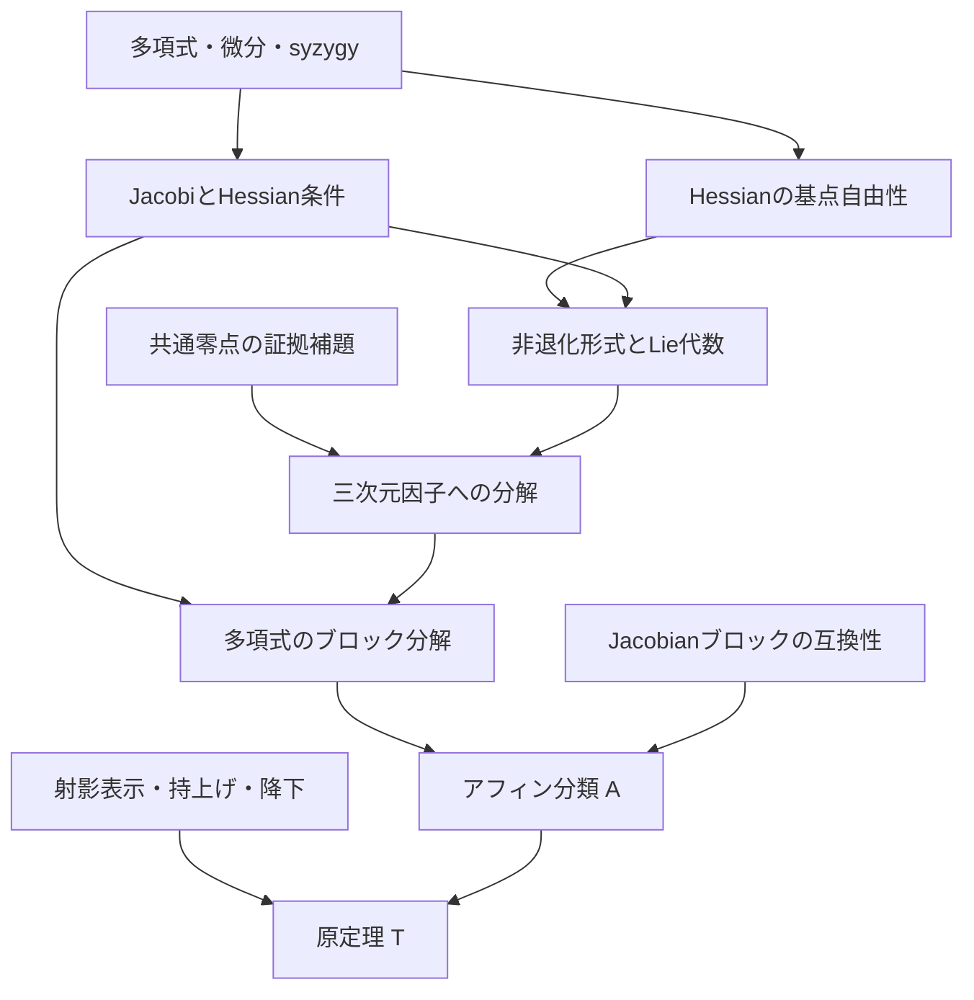

# 定理1.1(3)のBlueprint

2026-11-13 / Blueprint v0.4.0。原典は `paper/source.json` に固定する。
これは依存関係と証明設計であり、未形式化の結果を証明済みとする文書ではない。

数学的な本文は [Verso Blueprint](verso/README.md) の3章に置く。全19課題について、
主張・仮定・証明の分割・原典との対応・実装先候補を記述する。
このREADMEは目標と契約の入口、[tasks.json](tasks.json) は依存関係・受入条件・
状態の正本である。実装先候補は未作成ファイルを含む配置案で、証明済み宣言ではない。

| 本文 | 内容 |
|---|---|
| [多項式・Hessian・Jacobi](verso/NcCubicBlueprint/Chapters/Foundations.lean) | P0–P6b。座標変換、gradient syzygy、符号込みJacobi展開、多項式の分解と逆構成 |
| [対称形式とLie理論](verso/NcCubicBlueprint/Chapters/LieTheory.lean) | L0–L5。最大階数による非退化形式、support、根基・最高根の証拠、三次元分解 |
| [幾何学的な完成](verso/NcCubicBlueprint/Chapters/Completion.lean) | A・G0–G2・T。任意の射影切断の表示、Jacobi持上げ、降下と最終型 |

HTMLはルートで `bash scripts/build_blueprint.sh` を実行し、
`blueprint/verso/_out/site/html-multi/index.html` を開く。
式のある本文、依存グラフ、進捗表、検証済みLean宣言へのリンクを生成する。

## 1. 元の定理と二段階の目標

\(V\) を複素 \(N\ge5\) 次元ベクトル空間、\(F\in\operatorname{Sym}^3V^*\) を非零とし、
\(X=V(F)\subset\mathbf P(V)\) が滑らかとする。原論文の定理1.1(1)(2)による表示
\(q=\iota_{dF}P\)、\(P\in\Lambda^3V\) を得たとき、非零Poisson構造に対して
\(k\ge1,m\ge0,N=3k+m\) と線形座標 \(x_s=(x_{s1},x_{s2},x_{s3}),u\) が存在し、

\[
P=\sum_{s=1}^k\partial_{x_{s1}}\wedge\partial_{x_{s2}}\wedge\partial_{x_{s3}},
\qquad F=\sum_{s=1}^k f_s(x_s,u).
\]

各 \(f_s\) は全次数3で、同じ中心変数 \(u\) を共有してよい。括弧は
\(\{x_{s1},x_{s2}\}=\partial_{x_{s3}}f_s\) と循環置換で与えられ、ブロック間と中心変数の
括弧は0である。逆にこの表示はPoisson構造を与える。
座標、ブロック順序、中心三次式の配分の一意性は主張しない。

**アフィン目標 A** は、具体的な \(F,P\) と \(q\) のJacobi恒等式からこの表示を得ること。
**最終目標 T** は、任意の \(X\) 上のPoisson sectionに対してAを適用できることも示す。
元の定理には後者が必要である。

## 2. Leanに置いた正確なアフィン契約

`NcCubic/Statement.lean` は次を定義する。

| 記法 | Lean |
|---|---|
| \(V=\mathbf C^N\) | `CoordinateSpace N` |
| \(\mathbf C[z_1,\ldots,z_N]\) | `CubicPolynomial N`（名前は対象用途を示し、次数は別に仮定） |
| \(P\) | `AlternatingMap ℂ (Covector N) ℂ (Fin 3)` |
| \(q^{ij}=\sum_a P^{ija}F_a\) | `contractionCoefficients F P` |
| \(\{f,g\}=\sum_{i,j}q^{ij}f_i g_j\) | `bracketFromCoefficients q f g` |
| 全多項式に対するJacobi | `SatisfiesJacobi` |
| gradientの共通零点が原点のみ | `HasIsolatedGradientZero F` |
| 三次元ブロック＋中心の添字 | `BlockIndex k m := (Fin k × Fin 3) ⊕ Fin m` |
| 可逆な座標変換 | `Module.Basis (BlockIndex k m) ℂ (CoordinateSpace N)` |
| \(F\) の座標変換 | `polynomialInBasis F b` |
| 正規形の存在 | `HasBlockNormalForm F P` |
| アフィン分類の契約 | `AffineClassificationStatement` |

最後の命題は \(N\ge5\)、\(F\ne0\)、三次斉次性、gradient条件、\(P\ne0\) の下で
Jacobiと正規形を同値とする。**`def ... : Prop` を定義したことは証明ではない。**
この命題は `NcCubic.theorem113_affine` で証明済みである。

trivectorの正規形は、任意の3つの共変ベクトル \(\alpha_i\) に対して
\[
P(\alpha_0,\alpha_1,\alpha_2)
=\sum_s\det\bigl(\alpha_i(b_{s,j})\bigr)_{i,j=0}^2
\]
と記述している。このため単なる係数配列に交代性を仮定し忘れることがない。
外積 \(\Lambda^3V\) との比較はP0の課題として明示する。
\(F\) の変換は \(z_i=\sum_j(b_j)_i y_j\) の代入であり、\(P\) と同じ共変変換を誤って
施してはいけない。

`HasIsolatedGradientZero` と実際のscheme smoothnessの同値は `ChartComparison`・`CanonicalHypersurface` で検証済み。
全多項式Jacobiと座標生成元でのJacobiの同値はP3で証明済みである。

## 3. 証明の中心

原論文§3.1では、対称双線形形式 \(H\) の空間 \(K(P)\) を
\[
H(P(\alpha,\beta),P(\gamma,\eta))
+H(P(\beta,\gamma),P(\alpha,\eta))
+H(P(\gamma,\alpha),P(\beta,\eta))=0
\]
で定める。Jacobiatorは \(\sum_a F_a L_a\)、\(L_a\) は一次式に展開される。
gradientの一次syzygyがないことから \(L_a=0\) を得て、Hessianが \(K(P)\) に入る。

三次式の対称性
\(\operatorname{Hess}_F(p)(w,w)=2dF_w(p)\) と滑らかさから、この線形系は基点自由。
非退化な対称双線形形式を選び、\(P\) のsupport上に不変双線形形式を持つLie代数を作る。
式(3.2)を使って可解根基と階数2以上の単純因子を排除し、三次元因子だけを残す。
異なる因子間でHessianが消えるため、混合単項式も消え、\(F=\sum f_s(x_s,u)\) を得る。

ここで使う形式は**複素双線形**であり、Hermitian内積ではない。
`InnerProductSpace ℂ V` を流用しない。全Dynkin分類や全既約表現分類を丸ごと作る前に、
根基排除・高階数排除に必要な具体的な証拠の存在を小さく切り出す。

## 4. 依存関係

機械可読の正本は [tasks.json](tasks.json)。図は主要な経路を示す。

| 群 | 原論文 | 主な完成条件 |
|---|---|---|
| P0–P4 | 補題2.1、3.1 | 実際のsmoothnessからHessian条件・基点自由性 |
| L0–L5 | 補題3.2 | 基点自由性からtrivectorの三次元直和分解 |
| P5–P6b | §3.3 | 多項式の分解と逆構成 |
| A | 第3項のアフィン核心 | `theorem113_affine` |
| G0–G2 | 補題2.2、命題2.3–2.4 | 全幾何学的sectionとの接続 |
| T | 定理1.1(3) | faithfulな `theorem113` と最終監査 |

証拠を与えれば \(H(v,v)=0\) と示すL2と、その証拠が実際に存在するL3/L4を混同しない。
同様に正則列からsyzygyを記述するStacks側の補題と、gradientが正則列であるP2は別である。

Lie理論の課題は任意の基点自由なcompatible形式族を仮定する一般補題として作る。
そのためL1へP3・P4の依存辺を加えず、AでHessianの族に適用する。
P5では、ブロックtrivectorの等式と双対基底から混合Hessianの消滅を直接得られる。
Lie括弧を経由する場合は、可換で完全な因子の証拠を保持する必要がある。

## 5. 実装の区切り

1. **多項式基盤**：P0・P1からP4・P2・P3へ。P1の後のP4は短い独立課題となる。
2. **線形代数とLie理論**：L0・L1からL3・L4・L5へ。L2は条件付き計算として検証済み。
3. **アフィン分類**：P5とP6bを接続してAを証明する。
4. **元の幾何学的分類**：G0・G1・G2を接続し、最終型をレビューしてTを証明する。

現在の着手順は `python3 scripts/next_task.py` で取得する。アフィン分類まで完了し、現在の独立な着手点はG0の幾何学的表示である。
主要な未解決点はG0–G2の射影幾何の基盤。P2は大域Koszul H₁消滅の経路で解決済み。
予定モジュール名と原典の位置はtasks.jsonの `planned_module`・`source` に記録する。

## 6. 作業単位と終了条件

一つの作業で一つの明確な数学的補題を追加し、その型・証明・公理依存を確認する。
原論文の主張の弱化、係数体や次元の変更、genericへの限定は無断で行わない。
数学的な障害が判明すれば研究ノートと依存関係を現在の内容へ修正する。

未証明のノードは文書または命題の定義として保持する。`sorry` を並べた定理ファイルや
中心結果を仮定したtypeclassで緑のビルドを作ることを禁止する。
最終型の意味が元の定理と一致することは別途レビューし、その後だけ
`geometric_statement_review` を `passed` に変更する。

## 現在の到達点

`NcCubic.theorem113_affine : NcCubic.AffineClassificationStatement` を証明済み。
P0–P5・P6a・P6b・L0–L5・Aの15課題が完了した。G0・G1・G2・Tは未完了で、
任意の幾何学的Poisson切断を取り込む表示・持上げ・比較の基盤が残る。
実際の型と検証状況は [STATUS](../docs/STATUS.md) を参照する。
